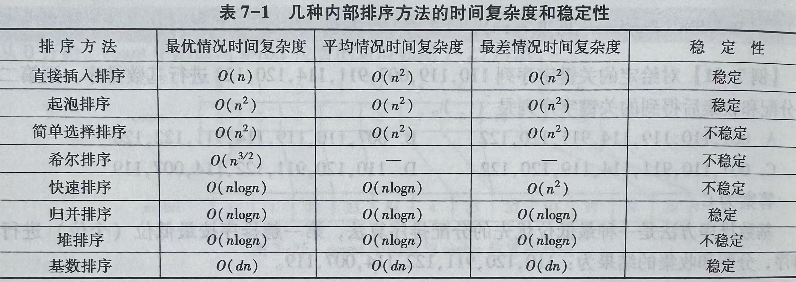
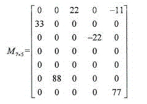
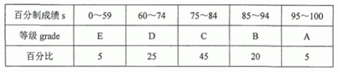
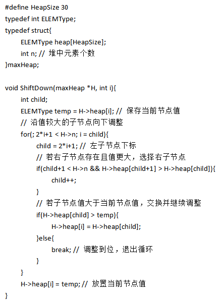
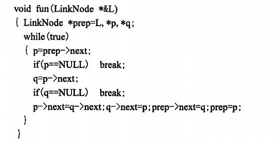

# Learning Log



## 选择题

1. 有5个分支结点的完全二叉树，其叶结点的个数只能是（<span style="color:#d94437">5 或 6</span>）

    对任意二叉树，设：
    - $n_0$：叶结点数（度为 0）
    - $n_1$：只有一个孩子的结点数（度为 1）
    - $n_2$：有两个孩子的结点数（度为 2）
    二叉树有一个重要关系：
    $$n_0=n_2+1$$

    题目说的“分支结点”是指非叶结点，所以分支结点总数是 $n_1+n_2=5$

    完全二叉树还有一个特点：最多只有一个结点有一个孩子，因此 $n_1$ 只能是 0 或 1。
    - 若 $n_1=0$，那么 $n_2=5$，叶结点数 $n_0=6$。
    - 若 $n_1=1$，那么 $n_2=4$，叶结点数 $n_0=5$。

2. 构造一棵含5个叶结点的哈夫曼树，需要确定的分支结点个数是（<span style="color:#d94437">4</span>）

    哈夫曼树有 \(n\) 个叶结点，就有 \(n-1\) 个分支结点

3. 已知二叉树T的前序遍历序列为a,b,c,d,e，则前序遍历序列与T相同的不同二叉树个数（不包含T）是（ <span style="color:#d94437">13</span> ）。

    这图我实在画不出来

## 填空题

1. 算法必须满足的五个准则是:<span style="color:#d94437">输入</span>、<span style="color:#d94437">输出</span>、<span style="color:#d94437">有穷性</span>、<span style="color:#d94437">确定性</span>和<span style="color:#d94437">可行性</span>

2. 递归求解过程中的最小子问题称为<span style="color:#d94437">递归终止条件或递归出口</span>

3. 在顺序表中，因为访问任一结点的方式是<span style="color:#d94437">随机访问</span>，所以访问每个结点的时间复杂度均为O(1)

4. 带有结构特性的数据元素集合称为<span style="color:#d94437">数据结构</span>

5. 树的<span style="color:#d94437">后序遍历</span>结果与其对应的二叉树的<span style="color:#d94437">中序遍历</span>序列相同。 

6. 对含n个元素的数据序列采用二路归并排序算法进行排序，算法的时间复杂度是<span style="color:#d94437">O(nlogn)</span>

7. 在数组中保存的链表称为<span style="color:#d94437">静态链表</span>

8. 已知完全二叉树的按层遍历序列存储在一维数组A[0..n-1]中，则A[i](1≤i≤n-1)的父结点是<span style="color:#d94437">A[(i-1)/2]</span>

9. 栈在函数调用中的作用是保存<span style="color:#d94437">函数调用信息</span>,以便函数返回后能恢复主调函数的执行状态

10. 为了实现分块查找,线性表必须采用<span style="color:#d94437">索引</span>方法存储

11. 图G中起点和终点可以相同但中间顶点不同的路径称为<span style="color:#d94437">简单路径</span>

12. 若选用的排序算法不稳定，则关键字相同的两个记录在排序前后的相对次序<span style="color:#d94437">不确定</span>

13. 由m个结点构成的二叉排序树，其可能的最大深度是<span style="color:#d94437">m</span>

14. 一个线性表如果需要频繁地按数据元素的关键字查找，则存储结构宜选择<span style="color:#d94437">散列存储</span>

15. 散列表的平均查找长度不是结点个数n的函数，而是<span style="color:#d94437">装填因子</span>的函数

16. 循环队列保存在长度为M的数组中，队头为front，队尾为rear，若要求队满时条件为真，则条件表达式应是<span style="color:#d94437">(rear + 1)%M == front</span>

17. 对n个数据元素的线性表进行希尔排序时，初始增量s（s是整数）的取值范围是<span style="color:#d94437">1≤s<n</span>

18. 数据的运算是定义在数据的<span style="color:#d94437">逻辑</span>结构上的

19. 图G的遍历过程实际上是对每个顶点搜索其<span style="color:#d94437">邻接点</span>的过程

20. 将森林T转换为一棵二叉树T1，则T中叶子结点在T1中满足的条件为<span style="color:#d94437">无左孩子</span>

21. 假设顺序存储的有序表R含有13个关键字，进行二分查找时，查找成功时平均查找长度为<span style="color:#d94437">41/13</span>
    对于含有 13 个关键字的有序表，判定树的结点分布如下：
    - 第 1 层（根结点）：$1$ 个结点，查找长度为 $1$
    - 第 2 层：$2$ 个结点，查找长度为 $2$
    - 第 3 层：$4$ 个结点，查找长度为 $3$
    - 第 4 层：$13 - 1 - 2 - 4 = 6$ 个结点，查找长度为 $4$

    公式计算

    查找成功时的平均查找长度 $\text{ASL}_{\text{success}}$ 计算公式为：

    $$
    \text{ASL}_{\text{success}}=\frac{1}{n}\sum_{i=1}^{h}(\text{第 }i\text{ 层的结点数}\times i)
    $$

    将数据代入：

    $$
    \begin{aligned}
    \text{ASL}_{\text{success}}
    &=\frac{1\times 1+2\times 2+4\times 3+6\times 4}{13}\\
    &=\frac{1+4+12+24}{13}\\
    &=\frac{41}{13}\approx 3.15
    \end{aligned}
    $$
## 名词解释


## 简答题

### 简述顺序表的优缺点

优点:①存储紧凑,无额外结构性开销(仅存数据);  
②支持随机访问,通过下标直接定位元素,访问时间复杂度O (1)。

缺点:①需预先分配固定空间,可能导致空间浪费(未用完)或溢出(空间不足);  
②插入、删除操作需移动元素,平均时间复杂度O (n)。

### 构造哈希函数时通常考虑的因素有哪些?

①计算哈希函数所需的时间。(1分)  
②关键字的长度。(1分)  
③哈希表的大小。(1分)  
④关键字的分布情况。(1分)  
⑤记录的查找频率。(1分)

### 简述栈和队列的异同点

相同点:  
①均为操作受限的线性表(仅允许在特定端点操作);  
②均可通过顺序存储(顺序栈、循环队列)或链式存储(链式栈、链式队列)实现;  
③插入、删除操作的时间复杂度均为O (1)(栈:栈顶;队列:队尾插入、队头删除)。

不同点:  
①操作端点不同:栈仅允许在一端(栈顶)插入和删除;队列允许在一端(队尾)插入、另一端(队头)删除;  
②操作原则不同:栈遵循“后进先出(LIFO)”;队列遵循“先进先出(FIFO)”;  
③应用场景不同:栈用于函数调用、表达式求值、回溯;队列用于层序遍历、任务调度、缓冲处理。

### 简述图的深度优先搜索(DFS)和广度优先搜索(BFS)的核心思想

**DFS核心思想**:从起始顶点出发,优先沿当前顶点的邻接顶点深度遍历(尽可能往“深”走),当无法继续深入时,回溯到上一顶点,选择未访问的邻接顶点继续遍历,直至所有顶点访问完毕。通常借助栈实现。
**BFS核心思想**: 从图中任意指定的起始顶点V开始，访问顶点V，然后访问与V相邻接的思普屁尚未被访问过的顶点，之后再依次访问与这些新近被访问过的那些顶点相邻接的尚未被访问的顶点

## 问答题

### 题1

设电文字符集是{e1,e2,e3,e4,e5,e6}，各字符出现的频次分别为{20,21,1,15,22,3}
现要为该字符集设计哈夫曼编码。请回答下列问题。

（1）给出构造的哈夫曼树。  
（2）给出各字符的哈夫曼编码。

### 题2

设循环队列保存在数组Q[N]中，front和rear分别为队头和队尾指针，初始时front=rear=0，约定指针rear指向的单元始终为空，请用C语言分别描述下列操作：

（1）将数据元素x入队。  
（2）将队首元素出队，并保存到变量myData中。  
（3）计算队列中当前数据元素的个数，并保存到变量DLenth中。


### 题3

己知稀疏矩阵M如下，采用三元组表存储。



（1）请给出三元组表的类型定义。  
（2）写出矩阵M按列优先存储的三元组表。


### 题4

将百分制成绩分成五个等级，已知成绩的对应关系及分布情况如下表所示。请回答下列问题。



（1）根据哈夫曼树的基本原理，画出成绩评定判定树T。  
（2）求树T的WPL。

## 算法阅读 1

### 原题

函数f31()的功能是:在一个升序排列的顺序表中，统计满足(min≤x≤max)的元素x的个数。请在空白处填写适当的语句使函数完整正确。

```c
#define ListSize 100
typedef int DataType;
typedef struct {
    DataType data[ListSize];
    int length;
} SeqList;

int f31(SeqList L, int min, int max)
{
    int k, pmin, pmax;
    if (L.length <= 0 || min > max)
        return 0;

    pmin = (1);
    for (k = 0; k < (2); k++) {
        if (L.data[k] < min)
            pmin = k;
        else if (L.data[k] <= max)
            pmax = k;
    }

    return (3);
}
```

### 思路


### 解答

---

## 算法阅读 2

### 原题

阅读下列算法，并回答问题

```c
void func(int r[], int n)
{
    int i,j;

    for (i = 2; i < n; i++)
    {
        r[0] = r[i];

        j = i - 1;

        while (r[0] < r[j])
        {
            r[j + 1] = r[j];
            j--;
        }
        r[j + 1] = r[0];
    }
}
```

(1)这是哪一种插入排序算法?该算法是否稳定?
(2)设置r[0]的作用是什么?

### 思路


### 解答

①直接插入排序；(2分)该算法稳定。(1分)  
②r[0]用来存储每次待插入的元素，免去查找过程中每次都要检测整个表是 否查找完毕，提高了查找效率。(2分)

---

## 算法阅读 3

### 原题

函数f31()的功能是：在一个按关键字递增有序、头指针为head的带头结点的单链表L中插入一个新结点，并保持链表L的有序性。请在空白处填写适当的语句使函数完整正确。

```c
typedef int KeyType;

typedef struct node{
    KeyType key;
    struct node *next;
} NODE;

typedef NODE *LinkList;

void f31(LinkList head,KeyType num)
{
    LinkList p;

    p=(LinkList)malloc(sizeof(NODE));

    p->key=num;

    while(head->next!=___(1)___&&head->next->key<num)
        head=___(2)___;

    p->next=___(3)___;

    head->next=p;

}
```

(1)这是哪一种插入排序算法?该算法是否稳定?  
(2)设置r[0]的作用是什么?

### 思路


### 解答

①直接插入排序；(2分)该算法稳定。(1分)  
②r[0]用来存储每次待插入的元素，免去查找过程中每次都要检测整个表是 否查找完毕，提高了查找效率。(2分)

---


## 算法阅读 3

### 原题

阅读以下堆调整(ShiftDown)算法代码(最大堆),回答问题:




(1)该算法的作用是什么?  
(2)若最大堆H的heap数组为[92,86,70,24,56,48,65,13],n=8,调用ShiftDown (H, 0)后,heap数组的前3个元素是什么?  
(3)该算法的时间复杂度是多少?

### 思路


### 解答


(1)算法的功能是从前向后将单链表L中的奇数序号结点和相邻的偶数序号结点交换。(3分)

(2)L=(2,1,4,3,6,5,8,7,9)。(2分)

---


## 算法阅读 3

### 原题

阅读下列关于单链表L的算法,并回答问题:




(1)指出fun(L)算法的功能。  
(2)当L=(1,2,3,4,5,6,7,8,9)时,执行fun(L)后L的结果是什么?

### 思路


### 解答

---

## 算法阅读 4

### 原题

顺序栈的类型定义如下：

```c
typedef struct{
    DataType data[MaxSize];
    int top;
}SeqStack;

SeqStack S;
```
规定栈底位置在数组下标为0的一端，请回答下列问题。

（1）用语句表示判断栈非空的条件。  
（2）用语句表示连续k（k为正整数）次出栈的操作。

### 思路


### 解答

（1）top≥0或top!=-1  
（2）
    
    int count=0;
    while(!StackEmpty(S)&&count<k){top--;count++;}  
    或  
    int count=0;while(count<k){Pop(&S);count++;}

---


## 算法设计

### 原题

二叉树的二叉链表类型定义如下:

```c
typedef struct node{
    int data;
    struct node *lchild,*rchild;
}BinNode;

typedef BinNode *BinTree;
```

编写函数f34(BinTree Bt),返回二叉树Bt中数据元素的最大值。  
函数的原型为:int f34(BinTree Bt)。


```c
int f34(BinTree Bt) {
    int max, lval, rval;

    if (Bt == NULL) {
        return MIN;
    }

    lval = f34(Bt->lchild);
    rval = f34(Bt->rchild);
    
    max = (lval > rval) ? lval : rval;

    return (Bt->data > max) ? Bt->data : max;
}
```

---


### 原题

已知顺序表SeqList定义如下：

```c
typedef struct{
    KeyType key;
    //InfoType otherinfo;
}RecType;
typedef RecType SeqList[MAXSIZE+1];
```


编写函数int f34(SeqList R,int n)，用双向冒泡排序法将n个元素的待排序列R按关键字降序排序，第1趟将最大元素排在数组下标为0的位置，第2趟将最小元素排在数组下标为n-1的位置，……，依此类推，最后1趟将中间排序码排在R的中心位置。

### 思路

> **← 第一个循环：最大值往左**
>
> `i` 从 `right` 递减到 `left + 1`。
>
> 如果 `R[i].key > R[i-1].key`，就交换，让较大的值往左移动。
>
> ---
>
> **→ 第二个循环：最小值往右**
>
> `i` 从 `left` 递增到 `right - 1`。
>
> 如果 `R[i].key < R[i+1].key`，就交换，让较小的值往右移动。
>
> **记忆口诀：最大往左，逆向扫；最小往右，正向扫。**

### 解答

```c
// 降序
int f34(SeqList R, int n)
{
    int left = 0, right = n - 1, i;
    RecType temp;

    while (left < right) {
        /* 从右向左：最大值移到左边 */
        for (i = right; i > left; i--) {
            if (R[i].key > R[i - 1].key) {
                temp = R[i];
                R[i] = R[i - 1];
                R[i - 1] = temp;
            }
        }
        left++;

        if (left >= right)
            break;

        /* 从左向右：最小值移到右边 */
        for (i = left; i < right; i++) {
            if (R[i].key < R[i + 1].key) {
                temp = R[i];
                R[i] = R[i + 1];
                R[i + 1] = temp;
            }
        }
        right--;
    }

    return 0;
}
```

```c
// 升序
int f34(SeqList R, int n)
{
    int left = 0, right = n - 1, i;
    RecType temp;

    while (left < right) {
        /* 从右向左：最小值移到左边 */
        for (i = right; i > left; i--) {
            if (R[i].key < R[i - 1].key) {
                temp = R[i];
                R[i] = R[i - 1];
                R[i - 1] = temp;
            }
        }
        left++;

        if (left >= right)
            break;

        /* 从左向右：最大值移到右边 */
        for (i = left; i < right; i++) {
            if (R[i].key > R[i + 1].key) {
                temp = R[i];
                R[i] = R[i + 1];
                R[i + 1] = temp;
            }
        }
        right--;
    }

    return 0;
}
```

---


### 原题

单链表类型定义如下：

```c
typedef struct node{
    int data;
    struct node *next;
}ListNode;

typedef ListNode *LinkList;
```

请编写一个函数，删除非空的带头结点单链表L中的最小值。函数的原型如下：

```c
void f34(LinkList L);
```

### 解答

```c
void f34(LinkList L)
{
    ListNode *prev, *curr;
    ListNode *min, *minprev;

    if (L == NULL || L->next == NULL)
        return;

    min = L->next;
    minprev = L;
    prev = L->next;
    curr = prev->next;

    while (curr != NULL) {
        if (curr->data < min->data) {
            min = curr;
            minprev = prev;
        }

        prev = curr;
        curr = curr->next;
    }

    minprev->next = min->next;
    free(min);
}
```


---


### 原题


设顺序表L按升序排列，请编写函数f34()，要求用二分查找确定插入位置，将元素x插入到L中，使L保持有序。

函数f34()的原型为：void f34(SeqList*L,DataType x)

### 解答

```c
void f34(SeqList *L, DataType x)
{
    int low = 0;
    int high = L->length - 1;
    int mid, i;

    /* 二分查找插入位置 */
    while (low <= high) {
        mid = (low + high) / 2;

        if (L->data[mid] < x)
            low = mid + 1;
        else
            high = mid - 1;
    }

    /* 元素后移 */
    for (i = L->length - 1; i >= low; i--)
        L->data[i + 1] = L->data[i];

    /* 插入 x */
    L->data[low] = x;
    L->length++;
}
```

---
