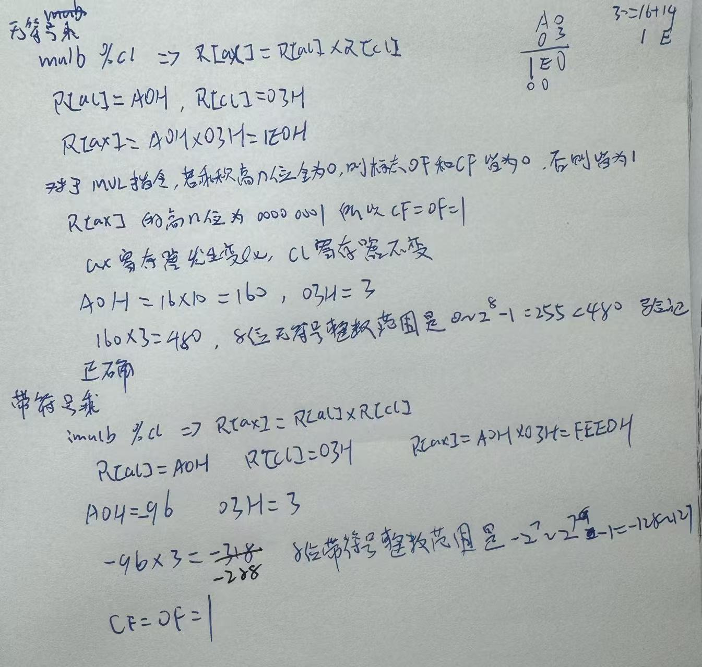
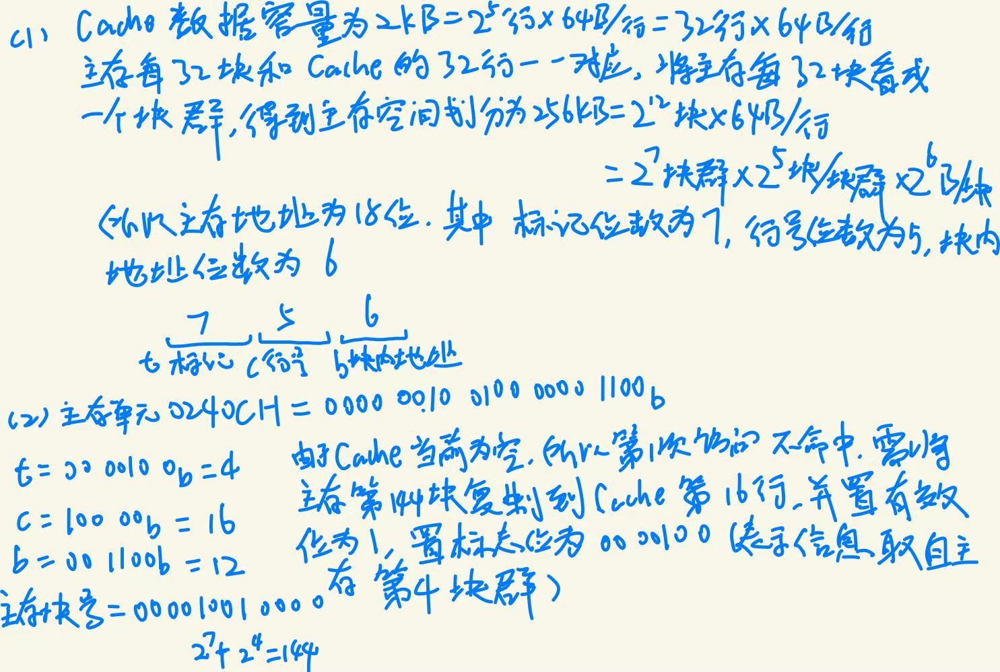
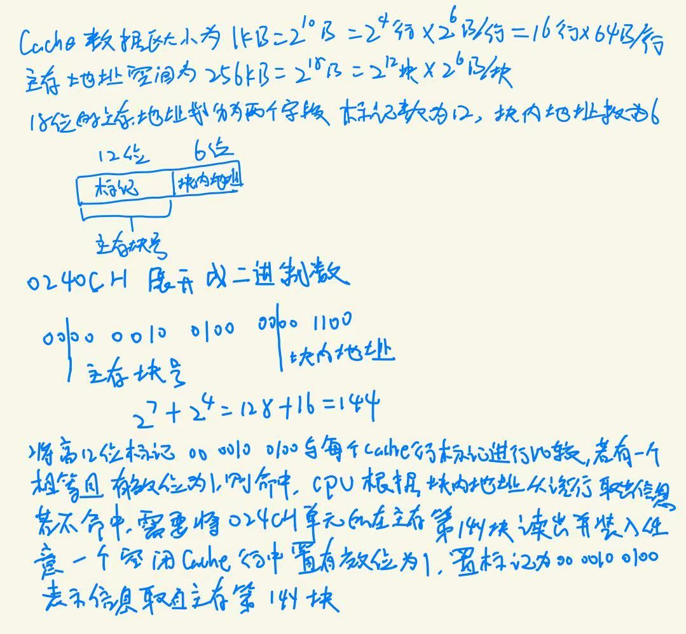
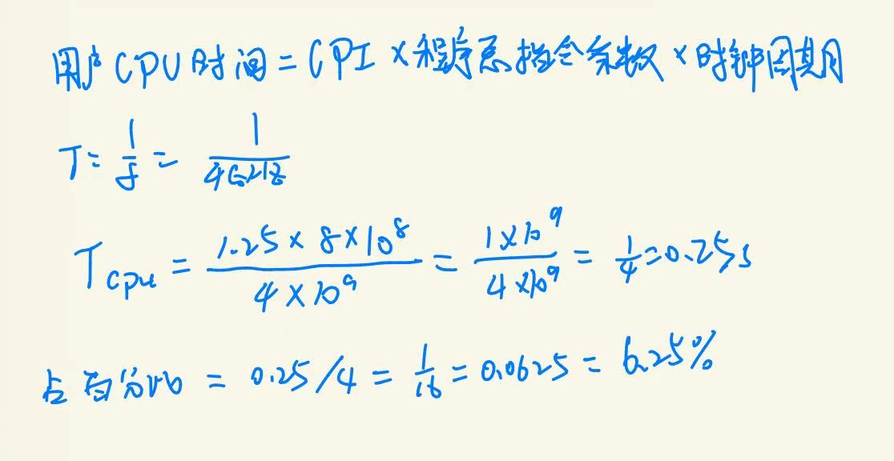
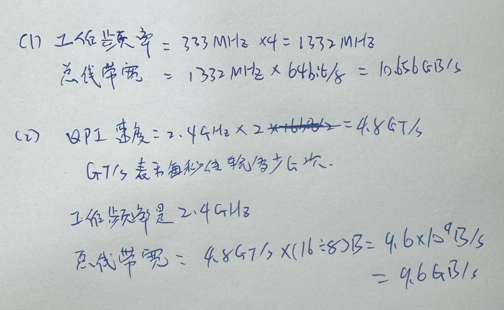
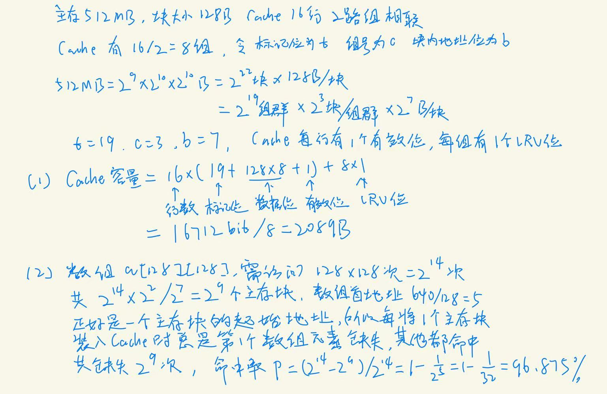

# Learning Log

## 填空题

1. 主存是存储器层次结构中的<span style="color:#d94437">核心</span>存储器，用来存放系统中被启动的<span style="color:#d94437">程序代码</span>和<span style="color:#d94437">数据</span>

2. cache 的写策略有<span style="color:#d94437">通写</span>法和<span style="color:#d94437">回写</span>法

3. 程序直接控制I/O方式的基本思想是直接通过<span style="color:#d94437">查询程序</span>来控制主机与外设的<span style="color:#d94437">数据</span>交换。

4. 栈是采用一种<span style="color:#d94437">先进后出</span>方式进行访问的一块存储区，在执行`pushw %ax`指令之后，`SP`指向存放有`AX`内容的单元，即当前刚入栈的<span style="color:#d94437">数据</span>

5. 动态链接有两种方式，一种是在程序<span style="color:#d94437">加载</span>过程中加载和链接共享库，另一种是在程序<span style="color:#d94437">执行</span>过程中加载和链接共享库
6. cache访存过程中，若cache缺失，则由<span style="color:#d94437">硬件</span>处理；若出现缺页，则由<span style="color:#d94437">软件</span>处理
7. 因为I/O统一编址方式下I/O访问和主存访问共用同一组<span style="color:#d94437">指令</span>所以其保护机制可由<span style="color:#d94437">虚拟存储</span>管理机制实现。
8. 中央处理器(CPU)的基本部件是<span style="color:#d94437">数据通路</span>和<span style="color:#d94437">控制部件</span>。
9. 指挥计算机如何操作的指令序列称为<span style="color:#d94437">程序</span>，指令操作的对象是<span style="color:#d94437">数据</span>。
10. CPU执行一条指令的大致过程,分成<span style="color:#d94437">取指令</span>、<span style="color:#d94437">指令译码</span>、<span style="color:#d94437">计算源操作数地址并取操作数</span>、<span style="color:#d94437">执行数据操作</span>、计算<span style="color:#d94437">目的操作数地址</span>并存结果、<span style="color:#d94437">计算下条指令地址</span>这几个步骤。
11. 整个结构体变量的对齐方式与其中对齐方式<span style="color:#d94437">最严格的成员</span>相同
12. 符号包括全局静态变量名和函数名，而<span style="color:#d94437">非静态局部变量名</span>则不是符号
13. 联合体的存储空间总是按<span style="color:#d94437">最大数据长度成员</span>所需空间大小为目标
14. 8(%edx,%ecx,4)的地址是<span style="color:#d94437">R[edx]+4*R[ecx]+8</span>
15. IEEE754单精度浮点数用二进制表示时，阶码的长度为<span style="color:#d94437">8</span>位，尾数的长度为<span style="color:#d94437">23</span>位
16. 同步控制方式的缺点是<span style="color:#d94437">在时间上安排不合理</span>或<span style="color:#d94437">对时间利用不经济</span>
17. <span style="color:#d94437">**.data**</span>节用来存入已初始化且初值不为0的全局变量和静态变量
18. 地址转换(Address Translation)工作由CPU中的<span style="color:#d94437">存储器管理部件(MMU)</span>完成
19. 已调入主存而被缓存在DRAM中的页称为<span style="color:#d94437">缓存页</span>
20. 运算部件的组成主要由<span style="color:#d94437">加法器</span>、<span style="color:#d94437">ALU</span>和<span style="color:#d94437">移位器</span>三部分构成。
21. 用来管理整个计算机系统的资源，包括对它们进行<span style="color:#d94437">调度</span>、管理、监视和服务等的软件称为<span style="color:#d94437">操作系统</span>
22. 在两个同号数相加时，当相加得到的<span style="color:#d94437">和或结果</span>超出了n位数可表示的范围时出现这种情况，此时发生了<span style="color:#d94437">溢出</span>现象。
23. 链接器在将多个可重定位文件组合成一个<span style="color:#d94437">可执行文件</span>时，主要完成<span style="color:#d94437">符号解析</span>和<span style="color:#d94437">重定位</span>两个任务。
24. 进程可以看成是<span style="color:#d94437">程序</span>的一次运行过程，因而它具有<span style="color:#d94437">动态</span>的含义。
25. 内核空间的I/O软件由<span style="color:#d94437">与设备无关的I/O软件</span>、<span style="color:#d94437">设备驱动</span>程序和<span style="color:#d94437">中断服务</span>程序 等三个部分组成。
26. 整数加减运算中,同号相加时,若结果的符号不同于<span style="color:#d94437">加数</span>的符号,则会发生<span style="color:#d94437">溢出</span>。
27. 目标代码指编译器或<span style="color:#d94437">汇编器</span>处理源代码后所生成的<span style="color:#d94437">机器语言</span>目标代码。
28. <span style="color:#d94437">软件识别</span>通常是在CPU中设置一个<span style="color:#d94437">原因寄存器</span>，该寄存器中有一些标识<span style="color:#d94437">异常原因</span>或<span style="color:#d94437">中断类型</span>的标志信息
29. Linux将进程对应的虚拟地址空间组织成若干<span style="color:#d94437">区域(Area)</span>的集合
30. 机器硬件直接执行微指令
31. 机器指令以什么方式提供操作数或操作数地址,称为<span style="color:#d94437">寻址方式</span>。
32. 在采用单符号的进位判溢出的补码运算中可用符号位进位与最高数值位进位异或来判断溢出。如果两个同号数相加产生了最高位的进位,此时若最高数值位<span style="color:#d94437">无进位</span>，则可以判定结果溢出。
33. 通常把数据通路中专门进行数据运算的部件称为<span style="color:#d94437">执行</span>元件或<span style="color:#d94437">功能</span>元件。
34. 虚拟地址空间分为两大部分:<span style="color:#d94437">操作系统</span>内核区和<span style="color:#d94437">用户虚拟</span>存储空间,分别简称为内核空间和用户空间。
35. 中断服务程序包含三个阶段:<span style="color:#d94437">准备</span>阶段、<span style="color:#d94437">处理</span>阶段和<span style="color:#d94437">恢复</span>阶段。
36. 根据指令给出的地址个数，指令可分为三地址指令、<span style="color:#d94437">二地址指令</span>、<span style="color:#d94437">单地址指令</span>、<span style="color:#d94437">零地址指令</span>四种。

## 名词解释

### 时钟周期

计算机执行一条指令的过程被分成若干步骤完成，每一步都要有相应的控制信号进行控制，计算机必须能够产生同步的时钟定时信号，即 CPU 主脉冲信号，其宽度称为时钟周期。 

### 数据通路

通常将指令执行过程中数据所经过的路径,(2 分) 包括路径上的部件称为数据通路。 (1 分)

### 栈帧

每个过程在栈中拥有的专属栈区,用于保存过程调用的入口参数、返回地址、被保存寄存器的值、非静态局部变量等数据。

### 机器数

通常将数值数据在计算机内部编码表示的数称为机器数。(3分)机器数中只有0和1两种符号,或机器数一定是一个0/1序列。(2分)

### 易失性存储器

在电源关闭时信息自动丢失,(3分)如主存(1分)和高速缓存(1分)都属于易失性存储器。

### 独立编址

独立编址方式对所有I/O端口单独编号，使它们成为一个与主存地址空间独立的I/O地址空间。采用该编址方式时，无法从地址码区分CPU访问的是I/O端口还是主存单元，因此指令系统中需要有专门的I/O指令表明访问的是I/O地址空间，I/O指令中地址码部分给出I/O端口号。CPU执行I/O指令时，会产生I/O读/写的总线事务，CPU通过该总线事务访问I/O端口。

### 统一编址

统一编址（也叫 “存储器映射 I/O” ）是计算机体系结构中 I/O 设备的一种编址方式，核心逻辑是： 将 I/O 设备的所有相关寄存器（如控制寄存器、数据寄存器、状态寄存器等 ）视为主存的一部分，为每个寄存器单独分配一个唯一的 “内存地址” ，并将这些地址纳入主存的地址空间中。

### 虚拟存储器

虚拟存储器是构造的一个大容量的存储系统,使得应用程序可以像使用内存一样使用辅助存储器的空间。

### 何谓虚拟存储器?其主要好处是什么?

定义：在存储管理部件（硬件）和操作系统的存储管理软件支持下，把“主存——辅存"作为一个整体，为程序员提供一个比主存大很多倍的软件编程空间，该存储空间就称为虚拟存储空间或虚拟存储器。(3分)  
好处：从整体上看，使存储系统的速度接近主存访问速度，而存储容量大，接近于辅存的容量。每位平均价格低，接近于辅存的每位平均价格。(2分)

### 动态链接

共享目标文件(共享库文件)能在可执行文件装入或运行时被动态地装入内存并自动被链接的过程,由动态链接器完成。

## 简答题

### 简述冯·诺依曼结构的基本思想

(1)采用“存储程序”工作方式;  
(2)计算机由运算器、控制器、存储器、输入设备和输出设备五大基本部件组成;  
(3)存储器能存放数据和指令,形式上无区别但计算机能区分,控制器能自动执行指令,运算器能进行基本算术和逻辑运算,操作人员通过输入/输出设备使用计算机;  
(4)计算机内部以二进制形式表示指令和数据,每条指令由操作码和地址码两部分组成,操作码指出操作类型,地址码指出操作数的地址,由一串指令组成程序。

### 简述计算机系统基本性能指标和CPU的性能指标

计算机系统的基本性能指标包括响应时间和吞吐率。(2分,1分/个)CPU的基本性能指标包括时钟周期时钟频率或主频CPI。(3分,1分/个)

### 简述原码乘法运算过程

用原码实现乘法运算时,符号位与数值位分开计算,因此,原码乘法运算分为两步。(1分)  

①确定乘积的符号位。由两个乘数的符号异或得到。(2分)  

②计算乘积的数值位。乘积的数值部分为两个乘数的数值部分之积。(2分)

### 简述浮点数加减法的运算步骤

(1)对阶:小阶向大阶看齐,阶小的数的尾数右移,右移位数等于两个阶的差的绝对值,使两数阶码相等;  
(2)尾数加减:对阶后进行定点原码小数的加减运算,需还原隐藏位并保留附加位;  
(3)尾数规格化:结果为±1b.bb…b时右规(尾数右移一位,阶码加1),结果为±0.00…01b…b时左规(尾数左移,阶码减1,直到第一位“1”移到小数点左边);  
(4)尾数舍入处理:按IEEE 754标准的就近舍入、朝+∞方向舍入、朝-∞方向舍入或朝0方向舍入模式处理;  
(5)阶的溢出判断:若正阶超过最大允许值,发生“阶上溢”,浮点数溢出由阶上溢判断,尾数溢出可通过右规纠正。

### 简述在递归深度较深时，递归调用的时间开销和空间开销都会较大的原因

每个过程包含准备阶段和结束阶段,并在栈中新增一个栈帧,(2分)因而,每增加一次过程调用,就要增加许多条包含在准备阶段和结束阶段的额外指令,并增加一个栈帧的空间,(2分)当递归调用深度较深时,这些额外指令的执行时间开销和栈帧的空间开销就会很大,有些情况下甚至发生栈溢出。(2分)

### RISC精简指令集计算机的特点

1. 指令数目少
2. 指令格式规整，采用定长指令字方式
3. 只有Load/Store指令中的数据需要访存
4. 采用大量通用寄存器

### I/O子系统的工作过程

首先，CPU在用户态下运行用户进程，当CPU执行到系统调用封装函数对应的指令序列中的陷阱指令时，会从用户态陷入内核态；转到内核态执行后，CPU会根据陷阱指令执行时EAX寄存器中的系统调用号，选择执行相应的系统调用服务例程；在系统调用服务例程的执行过程中，可能需要调用具体设备的驱动程序；在设备驱动程序执行过程中启动外设工作，外设准备好数据或准备好接收数据后，就发出中断请求：CPU响应中断后，就调出中断服务程序执行。在中断服务程序中控制主机与设备进行具体的数据交换。

### 简述程序直接控制I/O方式的基本思想

程序直接控制I/O方式的基本工作原理是直接通过查询程序来控制主机和外设的数据交换。(3分)该方式在查询程序中通过I/O指令读出外设或其设备控制器的状态后,根据状态来控制外设和主机的数据交换。(2分)

### 简述静态链接和动态链接的差别

静态链接方式因库函数代码被合并在可执行文件中,因而会造成盘空间和主存空间的浪费;(2分)另外,静态链接方式更新困难、使用不便。(1分)动态链接方式采用共享库的动态链接方式,它具有共享性和动态性,共享性可以节省主存资源和硬盘空间,动态性保证每次加载或执行程序时所链接的共享库总是最新的。(2分)

### CPU对异常和中断的响应过程可分为三个步骤？

保护断点和程序状态、关中断、识别异常和中断事件并转相应处理程序。

### 简述全局符号解析的规则？

- 规则1:强符号不能多次定义，否则链接错误。  
- 规则2:若出现一次强符号定义和多次COMMON符号或弱符号定义，则按强符号定义为准。  
- 规则3：若同时出现COMMON符号定义和弱符号定义，则按COMMON符号定义为准。  
- 规则4：若一个COMMON符号出现多次定义。则以其中占空间最大的一个为准。因为符号表中仅记录COMMON符号的最小长度，而不会记录变量的类型，因此在链接器确定多重COMMON符号的唯一定义时，以最小长度中的最大值为准进行符号解析.能够保证满足所有同名COMMON符号的空间要求。  
- 规则5：若使用编译选项-fno-common，则不考虑COMMON符号，相当于将COMMON符号作为强符号处理。

### i386 System V ABI对struct结构体数据的规则？

①整个结构体变量的对齐方式与其中对齐方式最严格的成员相同：  
②每个成员在满足其对齐方式的前提下，取地址最小的可用位置作为成员在结构体中的偏移量。这可能导致内部插空；  
③结构体大小应为对齐边界长度的整数倍。这可能会导致尾部插空。  
前两条规则是为了保证结构体中的任意成员都能以对齐的方式访问。

### 可重定位目标文件和可执行目标文件的主要差别是什么？

可执行目标文件由链接器将若干个相互关联的可重定位目标文件组合起来而生成。可重定位文件中的代码和数据的地址是相对于起始地址0而得到的，可执行文件中代码和数据的地址则按照操作系统规定的存储器映像来确定起始地址，并且可重定位文件中代码和数据的地址将会被修改，使得它们被重定位到运行时的虚拟存储空间中相应地址处。可执行目标文件格式与可重定位目标文件格式类似，例如，这两种格式中ELF头的数据结构一样，.text节、.rodata节和.data节中除了有些重定位地址不同以外，大部分都类似。相比于ELF可重定位目标文件，可执行目标文件的不同之处表现在以下几个方面：  
①ELF头中字段e_entry给出系统将控制权转移到的起始的虚拟地址(入口点),即执行程序时第一条指令的地址，而在可重定位文件中，此字段为0。  
②多了一个.init节，其中定义了一个_init函数，用于可执行目标文件开始执行时的初始化工作。  
③少了两个.rel节，因为可执行目标文件中的指令和数据已被重定位，故可去掉用于重定位的节。  
④多了一个程序头表，也称段头表(segment header table),可执行文件中的节与虚拟空间中的存储段之间的映射关系

### 汉字字符的编码有哪三类?简述各类编码的作用，并分别列举一个实际的编码

汉字的编码分为输入码、内码和输出字形码。(2 分)输入码是用于汉字信息的输入,比如拼音码;(1分)内码是用于汉字信息在计算机内部的存储和处理，比如区位码:(1分)榆出字形码是用于汉字信息的输出显示,比如字模点阵码。(1分)

### 说明“进位”和“溢出”在概念和应用上有何不同?

进位:二进制加法运算时向更高位的j进位。最高位的进位常用于无符号数的加法时判断有无溢出。  
溢出:两个有符号位进行加、减法运算的结果超出了给定的取值范围称为溢出。  
常用于带符号数运算。

### 设某机器字长为32位,数值位31位,符号位1位。定点原码小数表示时,最大正数(十进制)为多少?最小负数(十进制)为多少?

定点原码小数表示时最大正数(十进制)；最小负数: 
先求出31位数值位所能表示的最大正数(2的31次方),将其置于分母,分子为1,得到的分数就是31位数值位所能表示的最小正数(2的负31次方)。用1减去最小正数,答案就是最大正数。最小负数用同样的道理,只有符号是不一样的。

### 简述I/O子系统的层次结构及各层功能

I/O子系统分为I/O软件和I/O硬件两部分,其中I/O软件分为用户空间I/O软件和内核空间I/O软件:
① 用户空间I/O软件:含C标准I/O库函数(如fopen、fread)和系统调用封装函数(如open、read),向用户提供I/O操作接口,通过陷阱指令将I/O请求转换为系统调用;  
② 内核空间I/O软件:含与设备无关的I/O软件(提供文件系统、缓存层、通用块设备I/O层等公共功能,提供统一接口)、设备驱动程序(针对特定外设,实现程序直接控制、中断控制、DMA控制等I/O方式)、中断服务程序(响应中断请求,完成数据交换、进程状态切换等);  
③I/O硬件:含外设和设备控制器,在软件控制下完成具体I/O操作。

### 简述栈在处理过程调用时的作用,并列举16位架构下可用的栈相关指令

栈是一种采用“先进后出”方式进行访问的一块存储区 ,在处理过程调用时非常有 用。 (3 分) 大多数情况下 , 栈从高地址向低地址增长。 ( 1 分)16 位架构下有 pushw 和 popw 指令分别表示进栈和出栈。 (2 分)

### 简述文件系统所实现的功能。

文件系统要为上层的用户和应用程序提供文件抽象以及文件的创建、打开、读/写  和关闭等所有操作接口;(3 分) 另一方面 ,文件系统需要将抽象的文件标识与具体  的硬件设备建立关联 ,并通过相应的设备驱动程序实现系统调用接口规定的操作。 (3 分)

## 题目 1

### 原题

假设`R[eax]=000000A0H`, `R[ecx]=00000003H`, 请问：执行指令`mulb %cl`后，哪些寄存器的内容会发生变化？与执行`imulb %cl`指令所发生的变化是否一样？为什么？两条指令得到的`CF`和`OF`标志各是什么？请用该例给出的数据验证你的结论。

### 思路

- `IMUL`指令，可以显式的给出一个、两个或三个操作数
- `MUL`指令，只须显式给出一个操作数
- 只给出一个操作数`SRC`，则另一个源操作数隐含在累加器`AL/AX/EAX`中
- 结果存放在`AX(16位时)`或`DX-AX(32位时)`或`EDX-EAX`(64位时)。`DX-AX`表示32位乘积的高、低16位分别在DX和AX中，其他的含义类似


### 解答



---

## 题目 2

### 原题

某计算机系统采用DMA方式传输数据,硬盘传输带宽为128MB/s,每次DMA传输的数据量为4KB。用户进程A通过系统调用函数read一次读取4KB数据,从A发起系统调用到驱动程序向硬盘发出读命令需3μs;驱动程序向硬盘发出读命令后阻塞A并调度其他进程,上下文切换需1.5μs;硬盘完成数据传输后发送中断请求,CPU响应中断并调出中断服务程序需0.5μs;唤醒A后切换到A的上下文并从系统调用返回用户态需3μs。忽略DMA初始化和数据传输过程中其他额外开销,计算该轮数据传输的总耗时以及硬盘实际的数据传输率。

### 思路

### 解答

---

## 题目 3

### 原题

某程序编译后生成的目标代码由A、B、C、D四类指令组成,它们在程序中所占的比例分别为43%、21%、12%、24%,CPI分别为1、2、2、2。现对程序重新编译优化,A类指令条数减少了50%,其他类指令条数不变。要求:  

(1)计算优化前后程序的综合CPI;  

(2)假定程序在主频为50MHz的计算机上运行,计算优化前后的MIPS。

### 思路

### 解答

## 题目4

### 原题

某计算机系统采用虚拟存储器机制,页大小为4KB,虚拟地址为32位,物理地址为30位。假设某进程的虚拟地址0x8049120需转换为物理地址,页表项中该虚拟页对应的物理页号为0x102,且装入位为1。请设计地址转换过程,说明虚拟地址和物理地址的字段划分,并计算最终物理地址。

## 题目5

### 原题

某计算机主存最大寻址空间为4GB,按字节编址,假定用64M×8位的具有8个位平面的DRAM芯片组成容量为512MB、传输宽度为64位的内存条(主存模块)。  
回答下列问题:  
(1)每个内存条需要多少个DRAM芯片?  
(2)构建容量为2GB的主存时,需要几个内存条?  
(3)主存地址共有多少位?其中哪几位用于DRAM芯片内地址?哪几位用于选择芯片?

## 题目6

### 原题

假设计算机M的指令集中包含A、B、C、D四类指令,其CPI分别为1、2、4、6。某个程序P在M上被编译成两个不同的目标代码序列P1和P2,P1所含A、B、C、D四类指令的条数分别为4、2、2、1,P2所含A、B、C、D四类指令的条数分别为2、5、3、2。  

请回答:哪个代码序列总指令条数少?哪个执行速度快?它们的CPI分别是多少?

## 题目7

### 原题

假定cache采用直接映射相联方式,主存块大小为64B,按字节编址。cache数据区大小为2KB,主存空间大小为256KB。试回答下列问题:   
(1)主存地址如何划分?   
(2)假定cache当前为空,说明CPU对主存单元0240CH的访问过程。



## 题目8

### 原题

假定某程序P编译后生成的目标代码由A、B、C、D四类指令组成，它们在程序中所占的比例分别为50%、20%、20%、10%，已知它们的CPI分别为1，2，2，1。现重新对程序P进行编译优化，生成的新目标代码中A类指令条数减少了50%，其他类指令的条数没有变。请回答下列问题：  

（1）编译优化前后程序的CPI各是多少？  

（2）假定程序在一台主频为50MHz的计算机上运行，则优化前后的MIPS各是多少？

## 题目9

### 原题

某计算机按字节编址，其中已配有0000～7FFFH的ROM区，现在16K×4位的RAM芯片形成32K×8位的存储区，CPU地址为A15～A0。请回答下列问题：  
（1）RAM区的地址范围是什么？共需多少个RAM芯片？地址线中哪一位用来区分ROM和RAM区？  
（2）假定CPU地址线改为24根，地址范围000000～007FFFH为ROM区，剩下所有地址空间都用16K×4位的RAM芯片配置，则需要多少个RAM芯片？

## 题目10

### 原题

假定cache采用全相联方式，主存块大小为64B，按字节编址。cache数据区大小为1KB，主存空间大小为256KB。试回答下列问题：  
（1）主存地址如何划分？  
（2）说明CPU对主存单元0240CH的访问过程。



## 题目11

### 原题

假设某机器M的时钟频率为4GHz,用户程序P 在 M 上的指令条数为8×10⁸,其 CPI 为1.25,则P 在 M 上的执行时间是多少(请写出计算公式)?若在机器M 上从程序P 开始 启动到执行结束所需的时间是4s,则 P 的用户CPU 时间所占的百分比是多少?



## 题目12

### 原题

(1)若前端总线(FSB) 的时钟频率为333MHz, 采用4倍并发技术传输数据,总线数据宽 度为64位,则工作频率和总线带宽各为多少?  
(2)若QPI 总线时钟频率为2.4GHz, 每 个时钟周期传输2次数据,其有效数据位16位,则其速度为多少GT/s? 工作频率是多 少?总带宽是多少?



## 题目13

### 原题

某计算机的主存空间大小为512MB, 按字节编址。指令 cache 和数据 cache分离,两种 cache 均有16个cache 行,主存与 cache 交换的块大小为128B, 数据 cache 采用2路组 相联、通写法和LRU替换算法。现有程序P, 其伪代码如下所示。   

程序P:   

```c
int a[128][128];

int sum_array() {

    int i,j, sum = 0;
    for(i = 0; i < 128; i++) {
        for (j = 0; j < 128; j++) {
            sum += a[i][j];
        }
    }
    return sum;
}
```

假定i、j、sum 均分配在寄存器中,数组a 按行优先方式存放,其首地址640。试回答下列 问题:   

(1)数据 cache的总容量(包括标记和有效位等)是多少字节?   

(2)程序P 的数据命中率是多少?


